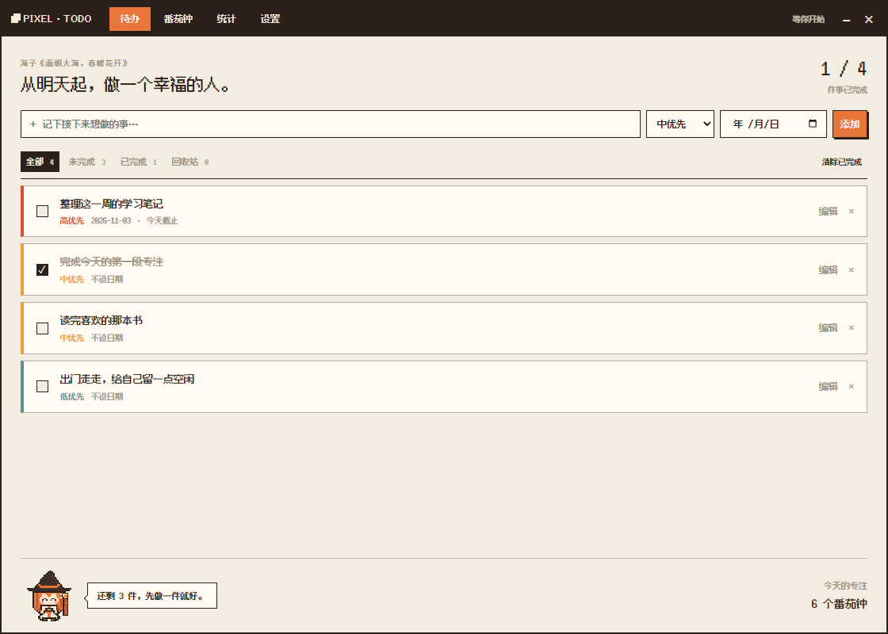
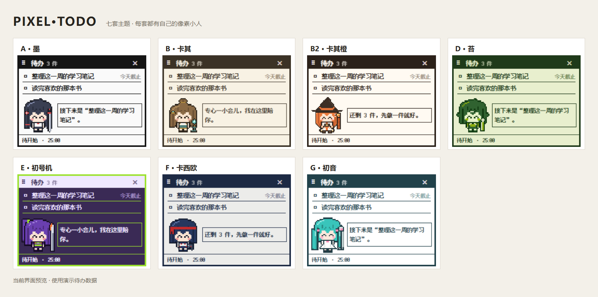
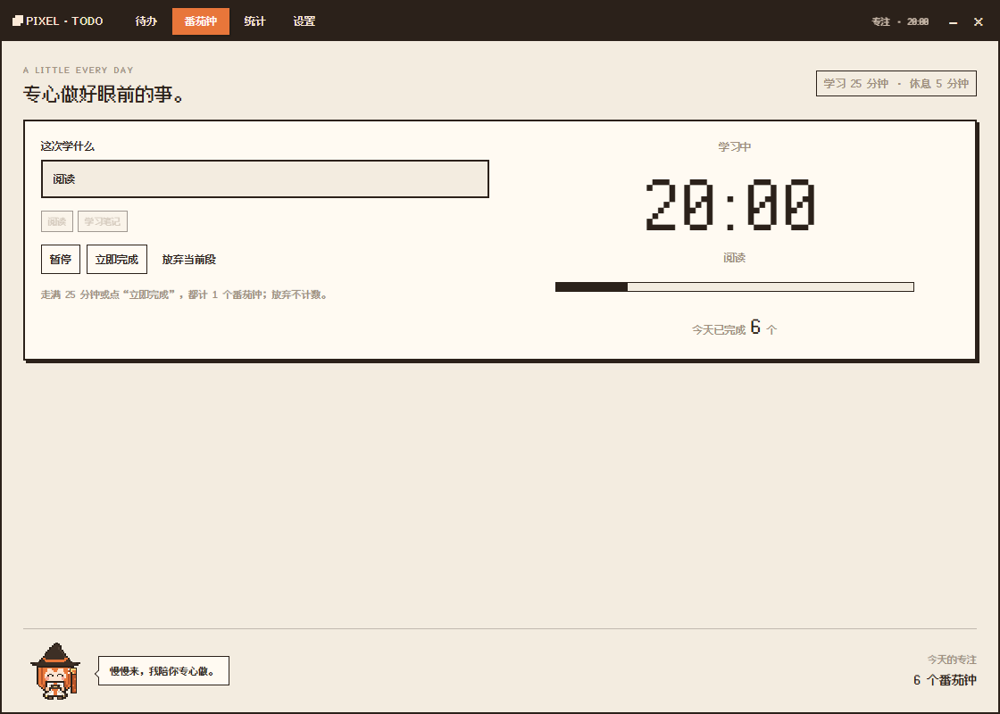
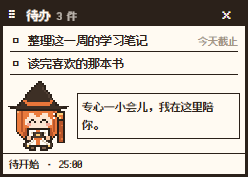
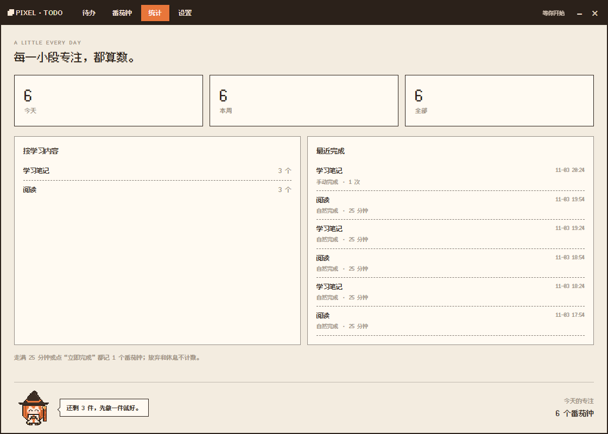
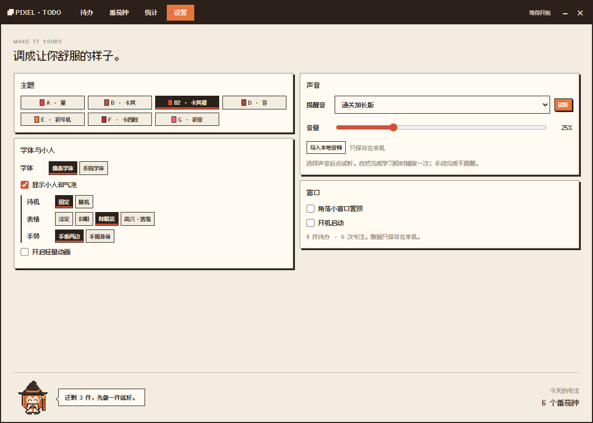

<div align="center">


# Pixel Todo

**一款像素风的桌面待办与番茄钟工具。**

把想做的事留在桌面一角，开始一段 25 分钟的专注。

Windows 桌面应用 · 七套主题 · 像素小人 · 数据本地保存

[认识功能](#功能介绍) · [看看主题](#七套主题) · [开始使用](#安装与使用) · [技术说明](#技术介绍)

</div>



> 以下预览来自当前软件界面，使用演示数据，不包含个人待办。

## Pixel Todo 是什么

Pixel Todo 把待办清单、番茄钟和专注记录放进一个像素风桌面应用里。平时用角落小窗查看接下来要做的事；需要整理任务或开始专注时，再打开完整窗口。

不用注册账户。任务、专注记录和个人设置保存在自己的电脑上。

## 七套主题

从黑白、卡其到紫绿和青粉，每套主题都配有对应的像素小人。主界面、小窗和到点提醒会一起切换。



| 墨 | 卡其 | 卡其橙 | 苔 | 初号机 | 卡西欧 | 初音 |
| :---: | :---: | :---: | :---: | :---: | :---: | :---: |
| 简洁黑白 | 温暖米棕 | 卡其与橙色 | 复古苔绿 | 深紫与亮绿 | 灰白与藏蓝红 | 青色与粉色 |

在 **设置 → 主题** 中点击切换。还可以选择像素字体或系统字体，调整小人的表情、手势和固定／随机待机，或关闭小人与动画。

## 功能介绍

### 待办清单：记下事情，也能找回误删

- 添加任务，设置高／中／低优先级和截止日期。
- 按全部、未完成、已完成筛选，查看当前完成进度。
- 修改任务文字、勾选完成，或删除不再需要的事项。
- 删除的任务先进入回收站，可以恢复或彻底删除；回收站中超过 7 天的任务会在启动时清理。

### 番茄钟：25 分钟专注，5 分钟休息

输入这段时间准备做什么，再点击开始。过程中可以暂停、继续或放弃；结束后进入休息。



| 操作 | 会发生什么 |
| --- | --- |
| 自然到点 | 记录 1 次专注，进入 5 分钟休息，并显示到点提醒 |
| 点击“立即完成” | 同样记录 1 次，进入休息；统计中标记为手动完成，不播放自然到点提示音 |
| 放弃本次专注 | 结束当前计时，不增加专注次数 |
| 跳过休息 | 结束休息，准备开始下一段专注 |

自然到点时会显示提醒窗口；声音可在设置中选择、试听、调整音量或导入自己的音频。

### 桌面小窗：想看时展开，挡住时收起



- 小窗显示近期待办、计时状态和像素小人，点击小窗打开完整窗口。
- 完整窗口的 **“−”** 收起并恢复小窗。
- 小窗的 **“×”** 隐藏到托盘，正在进行的计时继续运行。
- 自然到点会恢复提醒；想提前打开时，点击系统托盘里的 Pixel Todo 图标。
- 需要完全退出软件时，在托盘图标上右键选择 **退出**。

### 专注统计：看看时间花在了哪里

查看今天、本周和累计的番茄钟次数，按学习／工作内容归类，回看最近的记录，并区分自然完成和手动完成。



### 设置：调成自己习惯的样子

除了七套主题，还可以设置字体、小人、动画、窗口置顶、开机启动，以及提示音和音量。

<details>
<summary>展开查看设置界面</summary>



</details>

## 安装与使用

### 下载安装版

适用于 **Windows 10／11，64 位系统**。安装版无需安装 Git、Node.js 或开发工具。

1. 打开仓库的 [Releases 发布页](https://github.com/chorizocashmoney8-lang/Pixel-todo/releases)，获取发布版本的 Windows 安装包。如果发布页暂未提供附件，可向作者获取安装包。
2. 双击安装包，按向导选择安装位置，并按需勾选 **创建桌面快捷方式**。
3. 安装后从桌面快捷方式或开始菜单打开 **Pixel Todo**。

源码和安装包分开提供。仓库页面的 **Code → Download ZIP** 下载的是源码，需要按下方开发说明运行。

### 第一次打开，先做这几步

1. 点击桌面小窗，打开完整窗口。
2. 在 **待办** 页输入一件想做的事，按需设置优先级和日期，然后添加。
3. 在 **番茄钟** 页写下专注内容，点击开始。
4. 在 **设置** 页选一套主题，试听并调整提示音；需要时打开置顶或开机启动。
5. 日常可以只保留小窗；挡住桌面时点 **“×”** 隐藏，需要时从托盘打开。

### 数据保存在哪里

待办、专注记录和个人设置保存在本机：

```text
%APPDATA%\pixel-todo-desktop\
```

把这行地址粘贴到 Windows 文件资源管理器的地址栏即可打开。主要数据文件是 `pixel-todo.json`；迁移旧版数据时生成的备份文件是 `pixel-todo.json.v3.bak`。

需要备份时，先从托盘退出软件，再复制整个数据文件夹。分享源码时不需要附带这份个人数据。

## 技术介绍

Pixel Todo 使用 **Electron + 原生 HTML／CSS／JavaScript**，数据以本地 JSON 文件保存，Windows 安装包由 electron-builder 与 NSIS 构建。

| 部分 | 作用 |
| --- | --- |
| `main/` | 窗口、托盘、计时和本地数据保存 |
| `preload/` | 界面与主进程之间的受限通信接口 |
| `renderer/` | 主界面、小窗、提醒和共享主题 |
| `assets/` | 字体、图标和提示音 |
| `test/` | 自动化测试 |
| `build/` | 安装向导的自定义逻辑 |

想从源码运行，需要 Node.js 与 npm（本项目开发环境使用 Node.js 24）。在项目目录执行：

```bash
npm ci
npm start
```

依赖安装好后，也可以双击 `启动软件.cmd`；`创建桌面快捷方式.cmd` 用于创建源码版快捷方式。

- 开发、测试、打包和维护：[开发说明](docs/DEVELOPMENT.md)
- 产品需求：[PRD](docs/PRD.md)
- 实现结构：[技术设计](docs/TECH_DESIGN.md)

### 资源说明

像素字体使用 Fusion Pixel，采用 OFL-1.1 许可证，见 [字体许可证](assets/fonts/OFL.txt)。内置提示音由本项目合成。主题与角色名称用于说明视觉风格，不表示与相关品牌或作品存在官方关联。

